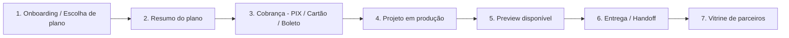

# PRD — Stokys (Plataforma de Captação e Execução de Projetos de Loja)

> Documento vivo. Versão 0.1 — 2026-08-13.

## 1. Visão geral

A **Stokys** é uma agência que monta lojas de dropshipping para clientes. Hoje esse processo (orçamento, negociação, produção, entrega) provavelmente acontece manualmente por WhatsApp/planilha. O objetivo desta plataforma é **substituir o orçamento manual por um fluxo self-service**: o cliente entra na LP, escolhe um dos **3 planos fixos** (Zen, Pro ou Customizado — seção 3), informa a plataforma (Shopify ou Nuvemshop) e os acessos necessários para a implementação, e ao final paga (PIX, cartão ou boleto) dentro da própria plataforma. A partir daí, o projeto entra em produção e o cliente acompanha tudo por um dashboard: status, mensagens com a equipe Stokys, preview da loja sendo construída.

Em paralelo, a plataforma serve como **hub de parceiros** — agências de performance/tráfego pago que podem ser recomendadas ao cliente depois que a loja fica pronta (a Stokys entrega a loja, o parceiro entrega o tráfego).

### Objetivo
Transformar geração de leads/orçamento em um fluxo self-service, sem idas e vindas manuais, e dar visibilidade total do progresso ao cliente sem depender de mensagens avulsas.

### Fora de escopo (por ora)
- **Minerador de produtos** — módulo existe na arquitetura mas fica **desligado por feature flag** (beta). Não faz parte do MVP funcional.
- Execução real da campanha de tráfego pago — isso é entregue pelos parceiros, não pela Stokys.
- Suporte multi-idioma / multi-moeda — plataforma nacional (BR), valores em BRL.

---

## 2. Personas

| Persona | Papel |
|---|---|
| **Visitante / Lead** | Chega pela LP, ainda não decidiu comprar. Precisa ser convencido e levado ao onboarding. |
| **Cliente** | Concluiu o onboarding e pagou (ou está pagando). Acompanha o projeto pelo dashboard: status, preview, mensagens, cobranças. |
| **Time de produção Stokys** | Executa o projeto (monta a loja conforme especificado no onboarding). Atualiza status, sobe preview, conversa com o cliente pela mensageria interna. |
| **Admin Stokys** | Gerencia os planos e seus preços, usuários, parceiros, financeiro, e tem visão de todos os projetos em andamento. |
| **Parceiro (agência de performance/tráfego pago)** | Cadastrado na plataforma para ser recomendado a clientes após a entrega da loja. Acesso restrito à própria área de parceiro (perfil, leads recebidos). |

---

## 3. Modelo conceitual: do onboarding ao projeto entregue



1. **Onboarding / Escolha de plano** — o lead escolhe um dos 3 planos (tabela abaixo), informa a plataforma (mesmo preço nas duas) e os acessos necessários para a implementação (seção 4.2.1). No plano Customizado, preenche também as personalizações (mercado-alvo, logotipo, paleta de cores).
2. **Resumo do plano** — tela final com o plano escolhido, o que está incluso, e o valor total. Lead pode revisar/voltar antes de confirmar.
3. **Cobrança** — ao confirmar, a plataforma gera a cobrança dentro dela mesma: QR Code + copia-e-cola PIX, formulário de cartão de crédito, ou boleto — sem redirecionar para um site externo do gateway.
4. **Projeto em produção** — pagamento confirmado vira um **Projeto** com status, atribuído à equipe de produção. Esteira interna (kanban) para o time Stokys.
5. **Preview disponível** — equipe sobe link/snapshot da loja em construção; cliente acompanha na área de preview do dashboard.
6. **Entrega / Handoff** — loja finalizada, acessos devolvidos/revogados (ver 4.2.1), projeto marcado como entregue.
7. **Vitrine de parceiros** — pós-entrega, cliente pode consultar a vitrine de parceiros de tráfego pago (seção 4.6). No plano Customizado, a mentoria com a Viscale Assessoria já está inclusa e é agendada pela produção (não depende da vitrine).

### Planos (o que compõe o preço)

O preço não é mais somado item a item — o cliente escolhe **um dos 3 planos**, cada um com escopo fixo. Preço de cada plano é **configurável pelo admin** (nome, escopo, preço), mas o escopo abaixo já está definido:

| | **Zen** | **Pro** | **Customizado** |
|---|---|---|---|
| Banners | 4 | 4 | 4 |
| Capas | Capa de categorias | Até 8 capas de categorias | 8 capas de coleções |
| Produtos | 15 produtos minerados e cadastrados | 15 produtos minerados e cadastrados | 35 produtos minerados e cadastrados |
| Tema | Spark ou Quart (**incluso, sem custo extra**) | Spark ou Quart (incluso) | Template Shopify para mercado **Brasil, Global ou Latam** + logotipo e paleta de cores personalizados |
| Extras | — | Página de política e rastreio | 1 Mentoria Estratégica com o Gestor de Tráfego parceiro (**Viscale Assessoria**) |
| Preço | *a definir* | *a definir* | *a definir* |

Plataforma (Shopify ou Nuvemshop) tem o **mesmo preço** nos 3 planos — a escolha não afeta o valor, só o processo técnico de implementação.

---

## 4. Módulos da plataforma

### 4.1 Landing Page (LP)
Página institucional da agência: proposta de valor, portfólio de lojas entregues, prova social, CTA principal levando ao onboarding. Segue exatamente o [design system Perk](DESIGN.md) (ver seção 8).

### 4.2 Onboarding
Wizard multi-step: (1) escolha do plano — Zen, Pro ou Customizado (comparativo lado a lado do que está incluso em cada um); (2) só para Customizado — personalização (mercado-alvo Brasil/Global/Latam, upload de logotipo, paleta de cores); (3) escolha da plataforma (Shopify ou Nuvemshop) + acessos da plataforma (4.2.1). **O wizard não inclui forma de pagamento** — ao concluir a última etapa, o cliente cai numa tela de resumo separada, e é só ali que a forma de pagamento é escolhida.

#### 4.2.1 Acessos da plataforma
Para implementar a loja, a produção precisa de acesso à conta do cliente na plataforma escolhida (Shopify ou Nuvemshop). O onboarding coleta esses acessos diretamente (login/senha ou API key, conforme a plataforma), e a orientação passada ao cliente é **desativar a autenticação de dois fatores (2FA)** da conta durante o período de implementação, para não travar o time de produção.

> **Nota de segurança:** pedir para o cliente desligar o 2FA reduz a segurança da conta dele enquanto o projeto está em produção — é uma troca consciente de conveniência por risco, então vale documentar isso claramente para o cliente no próprio formulário (ex.: "recomendamos reativar o 2FA assim que a loja for entregue"). Do lado da Stokys, os acessos armazenados precisam de tratamento como segredo: criptografados em repouso, visíveis só para quem está de fato produzindo aquele projeto, e **revogados/apagados após o handoff** (não ficam guardados indefinidamente). Se Shopify/Nuvemshop suportarem convite de "colaborador"/"equipe" com permissão restrita em vez de compartilhar a conta principal, isso é preferível a médio prazo — mas fica registrado aqui como melhoria futura, já que a orientação atual do cliente é compartilhar o acesso direto.

### 4.3 Cobrança (PIX / Cartão / Boleto) — via Asaas
Cobrança **integral (100%)**, gerada ao final do onboarding (não durante o wizard), **dentro da plataforma**, via [Asaas](https://www.asaas.com/):
- **PIX**: QR Code + código copia-e-cola, gerado via API do Asaas; confirmação automática por webhook.
- **Cartão de crédito**: formulário de cartão (tokenizado pelo Asaas — a Stokys nunca armazena dado de cartão em texto puro, escopo PCI minimizado).
- **Boleto**: geração de boleto registrado via Asaas, com linha digitável e PDF para download.

Ambiente **mockado primeiro** (formato de resposta idêntico à API do Asaas) até a integração real ser conectada — ver [dev.md](file:///C:/Users/55149/dev.md).

### 4.4 Dashboard do cliente
- Status do projeto (etapa atual da esteira de produção).
- Histórico de cobranças (pagas, pendentes, comprovantes).
- Área de preview (link/iframe da loja em construção, com histórico de snapshots).
- Mensageria interna com a equipe Stokys (thread por projeto).

### 4.5 Painel interno (admin / time de produção)
- Esteira (kanban) de todos os projetos em produção.
- CRUD dos planos (Zen, Pro, Customizado) — escopo e preço de cada um.
- Acessos de plataforma recebidos por projeto (visão restrita à produção responsável — ver nota de segurança em 4.2.1), com checklist de revogação pós-entrega.
- Para projetos Customizado: checklist para agendar a Mentoria Estratégica com a Viscale Assessoria.
- Financeiro: cobranças geradas, status de pagamento, conciliação.
- Gestão de parceiros (vitrine).
- Mensageria (visão da equipe, todas as threads).

### 4.6 Parceiros (agências de performance / tráfego pago)
**Vitrine simples**, não um fluxo de indicação: uma página/galeria com os parceiros cadastrados (nome, especialidade, foto/logo) e um **link direto para o WhatsApp** de cada um. Sem lead handoff dentro da plataforma, sem notificação interna — o contato acontece manualmente fora da Stokys a partir desse link. Cadastro dos parceiros é feito pelo admin (CRUD simples).

A **Viscale Assessoria** (gestor de tráfego parceiro) é um caso à parte: não depende da vitrine, porque já vem **inclusa como entregável do plano Customizado** (1 mentoria estratégica). Esse agendamento é tratado como uma etapa do próprio projeto (checklist da produção em 4.5), não como uma indicação avulsa.

### 4.7 Minerador de produtos — **beta, desligado por padrão**
Módulo planejado para pesquisar/importar produtos do **AliExpress** diretamente pela plataforma. Fica atrás de uma **feature flag desligada** — não aparece no onboarding nem no dashboard até ser habilitado explicitamente. Arquitetura deve prever o encaixe futuro (ex.: como uma opção adicional no catálogo do onboarding), mas nenhuma implementação é esperada no MVP.

---

## 5. Modelo de dados (entidades principais)

```
Cliente
 └─ Projeto
     ├─ status (enum: onboarding | aguardando_pagamento | em_producao | preview_disponivel | entregue)
     ├─ plano (enum: zen | pro | customizado) + preco_no_momento_da_compra
     ├─ plataforma (enum: shopify | nuvemshop)
     ├─ AcessoPlataforma (credencial criptografada em repouso; apagada/revogada após handoff — ver 4.2.1)
     ├─ Personalizacao (apenas plano customizado: mercado_alvo [brasil|global|latam] — define o template Shopify, idioma e método de pagamento final da loja publicada —, logo_url, paleta_cores[])
     ├─ Cobranca[] (metodo: pix | cartao | boleto; status: pendente | pago | expirado | estornado)
     ├─ Snapshot[] (preview da loja: link/imagem, data)
     ├─ Mensagem[] (thread do projeto: autor, texto, anexo, timestamp)
     └─ mentoria_viscale_agendada (bool, só relevante quando plano = customizado)

Plano (configurável pelo admin)
 ├─ nome (zen | pro | customizado)
 ├─ preco
 └─ escopo (banners, capas, produtos, tema_incluso, extras) — ver tabela da seção 3

Parceiro (vitrine pública, sem vínculo com Projeto)
 ├─ nome, especialidade, foto/logo
 ├─ link_whatsapp
 └─ ativo (bool)

Usuario
 ├─ papel (lead | cliente | producao | admin | parceiro)
 └─ permissoes
```

`preco_no_momento_da_compra` guarda uma **cópia do preço do plano no momento da escolha** (não uma referência viva a `Plano`) — se o admin mudar o preço de um plano depois, projetos já fechados não são afetados retroativamente.

---

## 6. Design & Marca

A LP e o dashboard seguem **exatamente** o design system definido em [`docs/DESIGN.md`](DESIGN.md) — inspirado no [Perk](https://www.perk.com/): fundo parchment/branco, único acento em lima elétrico (`#beff50`) reservado a ações primárias, tipografia OTSono (substituto: Inter) em apenas dois pesos (400/500), cards sem sombra com raio de 28px, pills com raio total. Não introduzir uma segunda cor de destaque nem usar sombras — a hierarquia vem de contraste tonal (branco → parchment `#f5f5eb` → lima `#beff50` → ilha escura `#30302a`), conforme os tokens e regras de "Do's and Don'ts" do documento de design.

O dashboard do cliente reaproveita a mesma paleta e tipografia da LP (não é um "produto" com skin diferente) — reforça que LP e área logada são a mesma marca.

---

## 7. Arquitetura técnica proposta

Segue a metodologia padrão do usuário ([dev.md](file:///C:/Users/55149/dev.md)) — Next.js + Neon/Drizzle + Vercel, ambiente mockado-primeiro para integrações externas.

| Camada | Escolha | Por quê |
|---|---|---|
| Frontend | Next.js (App Router) + TypeScript + Tailwind | Um único repo full-stack para LP pública + dashboard autenticado. |
| Backend | API routes / Server Actions do próprio Next.js | Volume inicial não justifica separar backend. |
| Banco de dados | Neon (Postgres serverless) + Drizzle ORM | Padrão do usuário; schema em código, migrations versionadas. |
| Autenticação | Cookie de sessão próprio + hash de senha (scrypt) | Padrão do usuário antes de introduzir provedor externo; papéis: cliente, produção, admin, parceiro. |
| Pagamentos | [Asaas](https://www.asaas.com/) | Cobre PIX + boleto + cartão nativamente via API, com webhook de confirmação. Construir mockado primeiro no formato real da API do Asaas. |
| Armazenamento de arquivos | Vercel Blob (ou S3-compatible) | Banners, previews de tema, anexos de mensagens, comprovantes. |
| Mensageria interna | Tabela própria (`Mensagem`) + realtime opcional (polling no MVP, websocket/SSE depois) | Não precisa de serviço de chat de terceiro na fase inicial. |
| Qualidade | ESLint + typecheck no pipeline de commit | Padrão do usuário. |
| Infra & deploy | Vercel, integrado ao GitHub | Deploy automático a cada push em `main`. |
| Dev assistido | Claude Code | — |

---

## 8. Segurança & compliance

- **PCI**: dado de cartão nunca toca o backend da Stokys em texto puro — tokenização feita pelo SDK do gateway no client-side.
- **LGPD**: dados pessoais de clientes tratados com finalidade específica (execução do projeto contratado); retenção e exclusão sob pedido.
- **Webhooks de pagamento**: validação de assinatura do gateway antes de marcar uma cobrança como paga (evitar falsificação de confirmação de pagamento).
- **Acessos de plataforma (Shopify/Nuvemshop)**: são segredo, não dado de perfil — criptografados em repouso (nunca em texto puro no banco), acessíveis só à produção alocada naquele projeto, nunca expostos no dashboard do cliente depois de enviados, e **revogados/apagados após o handoff** (checklist em 4.5). O pedido de desligar o 2FA durante a implementação é uma decisão de produto explícita, documentada ao cliente no próprio onboarding (ver nota em 4.2.1).
- **Acesso por papel**: cliente só vê seus próprios projetos/mensagens; parceiro só vê a própria vitrine, sem acesso a projetos; produção vê todos os projetos ativos (mas só os acessos de plataforma dos projetos que está executando); admin vê tudo, incluindo planos/preços e financeiro.

---

## 9. Roadmap por fases

**Fase 0 — Fundação**
Autenticação (papéis: lead/cliente, produção, admin, parceiro), schema base (Cliente, Projeto, Plano), LP estática seguindo o design system.

**Fase 1 — MVP funcional**
Onboarding completo (escolha de plano Zen/Pro/Customizado, personalização do Customizado, escolha de plataforma Shopify/Nuvemshop + coleta de acessos criptografados), tela de resumo final com cobrança mockada no formato da API do Asaas (PIX/cartão/boleto), dashboard do cliente (status + histórico de cobrança), painel admin com CRUD dos planos e seus preços.

**Fase 2 — Produção e acompanhamento**
Esteira interna (kanban) para o time de produção, área de preview no dashboard do cliente, mensageria interna (thread por projeto), integração real do Asaas (substituindo o mock).

**Fase 3 — Parceiros**
Vitrine de parceiros (CRUD pelo admin) com link direto para WhatsApp — sem fluxo de indicação/lead handoff dentro da plataforma.

**Fase 4 — Minerador de produtos (beta)**
Habilitar a feature flag, integrar com AliExpress, encaixar como opção adicional no catálogo do onboarding.

---

## 10. Decisões resolvidas

1. **Gateway de pagamento**: [Asaas](https://www.asaas.com/) — cobre PIX, cartão e boleto nativamente.
2. **Plataformas de loja suportadas**: Shopify e Nuvemshop (apenas essas duas no MVP).
3. **Temas**: 2 temas base — **Spark** (moda/vestuário) e **Quart** (decoração/casa). Sem catálogo maior por enquanto.
4. **Cobrança**: 100% integral (sem sinal + saldo). A escolha da forma de pagamento **não faz parte do wizard de onboarding** — só aparece na tela final, depois que o orçamento já está fechado.
5. **Faixas de produtos minerados**: 15 produtos (+R$ 97), 25 produtos (R$ 297), 35 produtos (R$ 397), 50 produtos (R$ 597).
6. **Parceiros**: processo manual — vitrine simples com link direto para WhatsApp de cada parceiro, sem fluxo de indicação/lead handoff dentro da plataforma.
7. **Minerador de produtos**: fonte de dados será o AliExpress (feature permanece desligada até a Fase 4).
8. **Preço por plataforma**: Shopify e Nuvemshop custam o mesmo — a plataforma não afeta o orçamento.
9. **Preço dos temas**: Spark e Quart são **inclusos, sem custo extra** em qualquer plano.
10. **Modelo de precificação**: substituído — não é mais um catálogo à la carte somado item a item. São **3 planos fixos** (Zen, Pro, Customizado), cada um com escopo pré-definido (seção 3).
11. **Acessos da plataforma**: o onboarding coleta login/acesso da conta Shopify/Nuvemshop do cliente, com recomendação de desligar o 2FA durante a implementação (ver nota de segurança em 4.2.1).

## 11. Decisões ainda em aberto

1. **Preço de cada plano**: valores de Zen, Pro e Customizado ainda não definidos — fica para depois, não bloqueia o início do desenvolvimento (o campo `preco` em `Plano` fica editável pelo admin, sem valor padrão fixo no código).
2. **Funcionalidades dos temas Spark e Quart**: usuário vai especificar depois (hoje só há a indicação de segmento — moda/vestuário para Spark, decoração/casa para Quart).
3. **Parcelamento no cartão**: quantas vezes, e se há juros ou é sem juros até X parcelas.
4. **Acessos de plataforma via colaborador restrito**: vale avaliar, como melhoria futura, convidar a produção como "equipe"/"colaborador" com permissão limitada na Shopify/Nuvemshop em vez de usar a conta principal do cliente — reduz o risco de compartilhar a conta inteira e evita depender de desligar o 2FA (ver nota em 4.2.1).

Resolvido nesta rodada: "Tema: Brasil, Global ou Latam" no Customizado é o **mercado-alvo da loja** — define o template Shopify usado, o idioma e o método de pagamento final da loja publicada (já refletido no modelo de dados, seção 5). E o Zen também inclui os produtos **cadastrados** na loja, não só a lista minerada — mesmo comportamento do Pro nesse ponto, escopo do Zen atualizado na tabela da seção 3.

---

## 12. Glossário rápido

- **Asaas**: gateway de pagamentos brasileiro usado pela Stokys, com suporte nativo a PIX, cartão e boleto via API.
- **PIX**: meio de pagamento instantâneo do Banco Central do Brasil.
- **Boleto**: instrumento de cobrança bancário brasileiro, com linha digitável.
- **Dropshipping**: modelo de venda onde a loja não mantém estoque próprio — o fornecedor envia direto ao cliente final.
- **Minerador de produtos**: ferramenta de pesquisa/importação de produtos de fornecedores para a loja.
- **Handoff**: momento de entrega do projeto finalizado ao cliente.
- **Zen / Pro / Customizado**: os 3 planos fixos de escopo oferecidos no onboarding (seção 3).
- **Viscale Assessoria**: parceiro de tráfego pago cuja mentoria estratégica já vem inclusa no plano Customizado (não faz parte da vitrine geral de parceiros).
